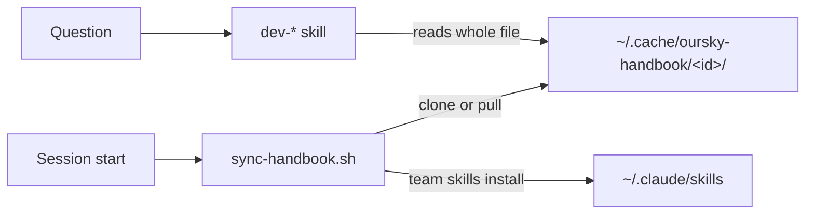

# handbook-plugin

Claude Code plugin. Gives agents Oursky's private handbooks as read-only reference and links the company handbook's team skills.



## Install

```bash
claude plugin marketplace add oursky/handbook-plugin
claude plugin install handbook
```

Needs `jq` and read access to `oursky/handbook-dev` and `oursky/handbook`. Clones go over https, so run `gh auth setup-git` first. An SSH `insteadOf` rule works too.

Restart Claude Code. Ask "what's our branch naming convention?" to check routing.

Update with `claude plugin marketplace update oursky-handbook`, then `claude plugin update handbook`.

## Behaviour

- First session clones every handbook in [handbooks.json](handbooks.json) in parallel.
- Later sessions serve the cache at once. A checkout older than 10 minutes pulls in a detached background job. The update shows next session.
- A failed handbook keeps its stale cache. The hook never exits non-zero.
- The hook runs the company handbook's team-skills install script. It links the chosen teams' skills.
- One `dev-*` skill per handbook topic. The skill reads the topic's files in full and uses `rg` for exact strings.

| Variable | Effect |
|---|---|
| `HANDBOOK_CACHE_DIR` | Cache root. Default `~/.cache/oursky-handbook`. |
| `HANDBOOK_REFRESH_MINUTES` | Pull age. Default `10`. `0` pulls every session. |
| `HANDBOOK_SYNC_FOREGROUND=1` | Pull and wait. |
| `OURSKY_TEAMS` | Teams to link, such as `"engineering projects"`. Default `engineering`. |
| `OURSKY_SKILL_TARGETS` | Space-separated link directories. Default Claude, Codex and OpenCode skill folders. |

## Commands

| Command | Purpose |
|---|---|
| `/handbook:sync` | Pull now. Prints each handbook's SHA and whether it moved. `--regen` regenerates skills. |
| `/handbook:usage` | Hits per handbook skill, split by Skill call and direct read, including never-hit ones. `--since 7d` windows it. |

Usage logging writes one line per handbook skill to `~/.claude/plugins/data/handbook-*/skill-usage.jsonl`. A `Skill` call logs `via: "skill"`. A Read, Grep, Glob or Bash call that touches the handbook cache logs `via: "read"` against the matching skill, or `handbook:<id>` when no skill matches. The report splits the two. It never logs prompts, paths or commands, and makes no network calls. It counts hits only, not missed hits. A skill at zero after real work has a description that misses how people ask.

## Adding a handbook

Add an entry to [handbooks.json](handbooks.json).

```json
{
  "id": "dev",
  "url": "https://github.com/oursky/handbook-dev.git",
  "topic_root": "./",
  "depth": 1,
  "label": "Oursky engineering handbook"
}
```

| Field | Purpose |
|---|---|
| `id` | Skill-name prefix and cache folder |
| `url` | https clone URL |
| `topic_root` | Folder holding the topics |
| `depth` | `0`: `topic_root` is one topic. `1`: each subfolder is a topic. |
| `label` | Corpus name in each skill description |
| `team_skills` | Optional. Folder holding `install.sh`. Such an entry has no `topic_root`. |

Then run the `handbook-authoring` skill and review the generated `skills/<id>-<topic>/SKILL.md`. It never overwrites an existing `description:` line. [skill-authoring.md](doc/skill-authoring.md) sets the description and trigger-noun rules.

## Development

```bash
git clone git@github.com:oursky/handbook-plugin.git ~/.local/share/handbook-plugin
claude plugin marketplace add ~/.local/share/handbook-plugin
claude plugin install handbook
```

A local clone runs the working tree. `/reload-plugins` picks up edits. A release bumps `version` in both [plugin.json](.claude-plugin/plugin.json) and [marketplace.json](.claude-plugin/marketplace.json).

Run `bash hooks/sync-handbook.test.sh` for the hook tests.
